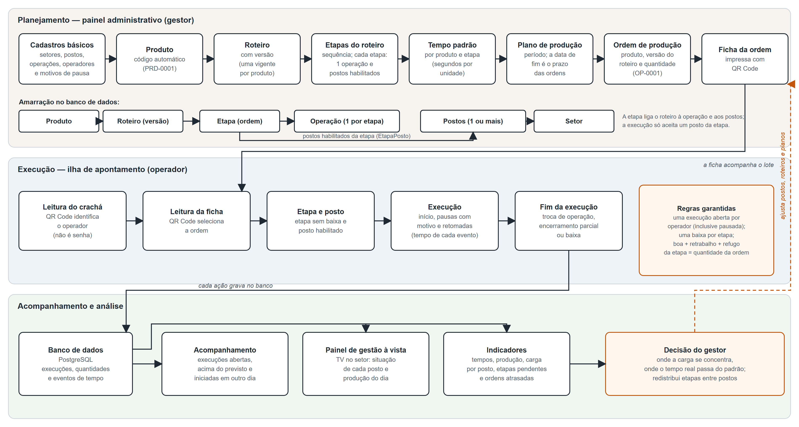

# GUNP — Sistema de Gerenciamento e Controle de Processos

Sistema web para registrar a produção e os tempos de cada etapa de uma linha de produção e apoiar o gestor no controle e no nivelamento dos processos. É o Trabalho de Conclusão de Curso de Ciência da Computação da UNIP, *Desenvolvimento de um Sistema Web para Gerenciamento e Controle de Processos em Linhas de Produção*, de Mateus Minoru Ganda, Arthur Álvaro Silva Garcia e Luis Gustavo Nunes dos Santos, com orientação do Prof. Me. Aldriano José da Silva.

A versão da branch `develop` fica publicada em <https://nivelamento-de-processos.vercel.app>.

## Onde está o TCC

| Documento | Arquivo |
| --- | --- |
| Texto do TCC (PDF) | [`docs/tcc/TCC_Nivelamento_de_Processos.pdf`](docs/tcc/TCC_Nivelamento_de_Processos.pdf) |
| Texto do TCC (Word) | [`docs/tcc/TCC_Nivelamento_de_Processos.docx`](docs/tcc/TCC_Nivelamento_de_Processos.docx) |
| Manual de utilização (PDF e Word) | [`docs/manual`](docs/manual) |
| Fluxograma geral do sistema | [`docs/domain/fluxograma-geral.png`](docs/domain/fluxograma-geral.png) |
| Fluxograma da execução na ilha | [`docs/domain/fluxograma-execucao-ilha.png`](docs/domain/fluxograma-execucao-ilha.png) |

Os arquivos do TCC mantêm o nome do título original, *Nivelamento de Processos*, que é também o nome do repositório; por sugestão da banca, o título passou a ser *Gerenciamento e Controle de Processos*.

## Como o sistema funciona



1. **Planejamento (gestor, no painel):** cadastros de setores, postos, operações, operadores e motivos de pausa; produtos com roteiro versionado; em cada etapa do roteiro, uma operação (o que se faz) e os postos habilitados (onde se faz); tempo padrão por produto e etapa; planos de produção, cuja data de fim é o prazo das ordens; ordens de produção com ficha impressa e QR Code.
2. **Execução (operador, na ilha):** o crachá identifica o operador e a ficha seleciona a ordem; o operador escolhe a etapa e o posto e registra início, pausas com motivo, retomadas e o fim da execução, que pode ser troca de operação, encerramento parcial (fim de turno, a etapa fica pendente) ou baixa (conclui a etapa).
3. **Acompanhamento e análise:** execuções abertas no painel, painel de gestão à vista nas TVs e indicadores de tempos, produção, carga por posto, etapas pendentes e ordens atrasadas.

O fluxo detalhado da ilha está no [fluxograma da execução](docs/domain/fluxograma-execucao-ilha.png).

## Situação do código em 26/11/2026

Implementado no repositório:

- login com matrícula e senha, e API de usuários administrativos;
- painel administrativo com menu lateral, temas claro e escuro, listas paginadas e ações de cada registro reunidas em um menu;
- cadastros de Produtos, Operações, Setores, Postos, Operadores e Motivos de Pausa, com criação, listagem, edição e ativação/inativação;
- códigos automáticos e permanentes: produtos (`PRD-0001`), postos, setores, planos (`PLN-0001`), ordens (`OP-0001`) e matrícula dos operadores, preservando os códigos antigos;
- Roteiros versionados com etapas, postos habilitados, produtos, vigência e tempos padrão;
- Planos e Ordens de Produção, com a versão do roteiro gravada em cada ordem, ficha impressa com QR Code e crachá do operador;
- ilha de apontamento em `/ilha`, liberada por chave do terminal (que o administrador troca no painel), com identificação pelo crachá ou pela matrícula, início, pausa com motivo, retomada, troca de operação, encerramento parcial no fim do turno e baixa com as quantidades boa, de retrabalho e de refugo;
- acompanhamento das execuções abertas, com os avisos "acima do previsto" e "iniciada em outro dia";
- painel de gestão à vista para TVs, com cadastro dos aparelhos e monitoramento da conexão;
- tela de Indicadores, com posição das ordens (e ordens atrasadas pelo prazo do plano), etapas pendentes com apontamento parcial, série por dia, qualidade, tempos por posto, tempo padrão e carga pendente, exportação em planilha e impressão;
- banco de dados com 16 tabelas, criado por migrações.

O acompanhamento das fases está em [`docs/plan/ROADMAP_GUNP.md`](docs/plan/ROADMAP_GUNP.md).

## Tecnologias

- Next.js 16 (App Router), React 19 e TypeScript
- Tailwind CSS 4
- PostgreSQL com Prisma 8
- NextAuth 4 (credenciais) e Argon2id para as senhas
- Testes com `node:test`

## Como rodar

Requisitos: Node.js 22 e acesso a um banco PostgreSQL.

```bash
git clone https://github.com/MateusGanda/Nivelamento-de-Processos.git
cd Nivelamento-de-Processos
npm ci
cp .env.example .env
```

Preencha o `.env` (veja a tabela abaixo) e inicie:

```bash
npm run dev
```

O sistema abre em <http://localhost:3000>.

### Variáveis de ambiente

O arquivo `.env` não vai para o Git. Nunca coloque senhas ou a string de conexão em commits, issues ou mensagens.

| Variável | Para que serve |
| --- | --- |
| `DATABASE_URL` | String de conexão do PostgreSQL. A do banco da equipe é passada em particular. |
| `NEXTAUTH_SECRET` | Segredo que assina as sessões. Gere um valor próprio para cada ambiente. |
| `INITIAL_ADMIN_NOME`, `INITIAL_ADMIN_EMAIL`, `INITIAL_ADMIN_MATRICULA`, `INITIAL_ADMIN_SENHA` | Usadas só pelo comando que cria o primeiro administrador. |
| `SEED_DATABASE_URL` | Banco de desenvolvimento que recebe os dados fictícios do seed. Nunca o banco do site. |

Para gerar um valor para o `NEXTAUTH_SECRET`:

```bash
node -e "console.log(crypto.randomBytes(32).toString('base64'))"
```

### Primeiro administrador

Não existe cadastro público de usuário. O primeiro administrador é criado pelo comando abaixo, que só funciona enquanto não houver um administrador ativo no banco:

```bash
npm run bootstrap:admin
```

Depois disso, novos usuários são criados pela API, por um administrador conectado. Ainda não há tela para isso.

## Banco de dados

O modelo de dados está em [`src/prisma/contract.prisma`](src/prisma/contract.prisma) e as migrações em [`migrations/app`](migrations/app). O arquivo [`docs/sql/schema.sql`](docs/sql/schema.sql) reúne os mesmos comandos em um único script, para consulta ou para criar o banco manualmente em um PostgreSQL vazio.

```bash
npx prisma migration status   # mostra as migrações aplicadas
npx prisma db verify          # confere se o banco está igual ao modelo
npx prisma db migrate         # aplica as migrações pendentes
```

Os dois primeiros comandos só leem. Não aplique migrações nem altere o modelo no banco da equipe sem combinar antes.

### Evolução de Setores e Operadores — 21/10/2026

Setores recebem código automático (PES1, COS1); novos operadores exigem setor principal e recebem matrícula permanente (LGNS-PES1, LGNS2-PES1). Função é opcional, e a edição preserva a matrícula. Cadastros antigos não são convertidos. Contrato: [operadores-setores.md](specs/contratos/operadores-setores.md).

As migrations add_setor_codigo e add_operador_setor_funcao estão preparadas. Aplicá-las pelo processo de deployment antes de utilizar esta versão com o banco; esta entrega não as executou no banco da equipe. O seed foi ajustado, sem execução automática.

### Dados fictícios para testes

O comando `npm run seed:desenvolvimento` grava uma fábrica fictícia (setores, postos, operações, operadores, motivos de pausa, produtos com roteiro, um plano, seis ordens e execuções com pausas e baixas) no banco indicado em `SEED_DATABASE_URL`. A equipe usa para isso a branch Indicators do Neon. O comando grava tudo numa transação, recusa rodar no mesmo banco de `DATABASE_URL` e não grava nada se algum registro do cenário já existir.

## Comandos

| Comando | O que faz |
| --- | --- |
| `npm run dev` | Inicia o sistema em modo de desenvolvimento. |
| `npm run build` | Compila para produção. |
| `npm run start` | Inicia a versão compilada. |
| `npm run lint` | Confere o padrão do código. |
| `npm run typecheck` | Confere os tipos do TypeScript. |
| `npm test` | Roda os testes automatizados. |
| `npm run bootstrap:admin` | Cria o primeiro administrador. |
| `npm run seed:desenvolvimento` | Grava dados fictícios no banco de `SEED_DATABASE_URL`. |

Os testes não usam o banco de dados. Os testes de login por HTTP são opcionais e só rodam com a aplicação local em execução e a variável `GUNP_HTTP_TEST_URL` definida, por exemplo `GUNP_HTTP_TEST_URL=http://localhost:3000`.

## Organização do projeto

```text
app/          páginas do sistema e rotas da API
modules/      código por módulo (access, operators, sectors, operations,
              products, workstations, pause-reasons, routings,
              production-plans, production-orders, executions e indicators),
              dividido em domain, application, infrastructure e presentation
shared/       validações usadas por mais de um módulo
src/prisma/   modelo de dados e conexão com o banco
migrations/   migrações que criam as tabelas
scripts/      comandos de apoio
tests/        testes automatizados
docs/         documentação do projeto e o TCC
specs/        contratos e pendências do modelo
```

As regras de cada camada estão em [`docs/architecture/ARCHITECTURE.md`](docs/architecture/ARCHITECTURE.md).

## Documentação

- [`docs/CONTEXTO_DO_PROJETO.md`](docs/CONTEXTO_DO_PROJETO.md): visão geral e decisões do projeto
- [`docs/domain/MODELO_CONCEITUAL_GUNP_atualizado.md`](docs/domain/MODELO_CONCEITUAL_GUNP_atualizado.md): entidades e regras de negócio
- [`docs/domain/diagrama-er.drawio.png`](docs/domain/diagrama-er.drawio.png): diagrama entidade-relacionamento do banco de dados
- [`docs/domain/diagrama-de-classes.drawio.png`](docs/domain/diagrama-de-classes.drawio.png): diagrama de classes
- [`docs/domain/diagrama-de-casos-de-uso.drawio.png`](docs/domain/diagrama-de-casos-de-uso.drawio.png): diagrama de casos de uso
- [`docs/domain/fluxograma-geral.png`](docs/domain/fluxograma-geral.png) e [`docs/domain/fluxograma-execucao-ilha.png`](docs/domain/fluxograma-execucao-ilha.png): fluxogramas do sistema e da execução na ilha
- [`docs/technology/TECHNOLOGY.md`](docs/technology/TECHNOLOGY.md): tecnologias e padrões
- [`docs/design/CADASTROS_GUNP.md`](docs/design/CADASTROS_GUNP.md): telas existentes, lacunas e fila sugerida de detalhamento
- [`specs/contratos/identificadores-cadastros.md`](specs/contratos/identificadores-cadastros.md): padrão de geração automática dos próximos cadastros
- [`specs/contratos/operadores-setores.md`](specs/contratos/operadores-setores.md): formatos e regras já implementados de matrícula e código de setor
- [`specs/contratos/indicadores.md`](specs/contratos/indicadores.md): contrato da consulta de indicadores
- [`docs/tcc`](docs/tcc): texto do TCC, em PDF e Word
- [`docs/manual`](docs/manual): manual de utilização do sistema, em PDF e Word
- [`AGENTS.md`](AGENTS.md): regras para o uso de ferramentas de IA no projeto

## Como contribuir

1. Atualize a `develop` e crie a branch a partir dela, com o tipo no nome: `feat/...`, `fix/...`, `docs/...`.
2. Use Conventional Commits: `feat: ...`, `fix: ...`, `docs: ...`, `chore: ...`.
3. Só abra o pull request para a `develop` depois de testar na branch.
4. Todo pull request passa pela verificação automática (lint, tipos, testes e build). Faça o merge só com ela verde e depois de conferir os arquivos alterados.
5. Arquivos criados só para teste local não vão para o Git.
